# AI-assisted Development Showcase

This repository documents my approach to AI-assisted software development, using GitHub Copilot and large language models (LLMs) as tools throughout the development process.

My approach combines human-driven system design, AI-assisted implementation, and critical evaluation of the results. I use AI tools to translate concepts into working software, explore implementation alternatives, investigate potential issues, and examine the plausibility and consistency of complex systems.

The project presented here is a practical example of this approach. The documentation showcases the goals, design concepts, and results of a simulation developed in Unity, demonstrating how AI-assisted development can be applied to a complex system involving interconnected models, constraints, and emergent behavior.

Note: This repository contains project documentation and visualizations rather than the simulation's source code. Its purpose is to showcase the project and my approach to AI-assisted development. [Further details for AI-assisted development process](#ai-assisted-development)

## World Generator and Medieval Economy Simulation

This project explores how geography, natural resources, transportation costs, and agricultural productivity shape settlement patterns and economic development in a simulated medieval world.

The simulation generates a procedural world with realistic geographical features, simulates its ecosystem, and evaluates suitable locations for settlements based on environmental and economic factors. It then models how terrain, resource availability, transportation constraints, production, consumption, and spoilage influence local economies.

The goal is to create a coherent simulation in which settlement patterns and economic outcomes emerge from the interaction of the world's geographical, ecological, and economic systems.

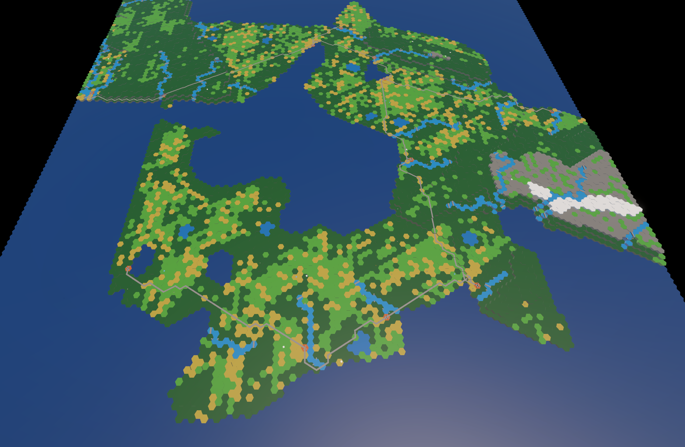

## Features

### Procedurally Generated World

The world is generated by simulating plate tectonics and erosion. This produces plausible continents with varied topography, mountain ranges, rivers, and lakes.

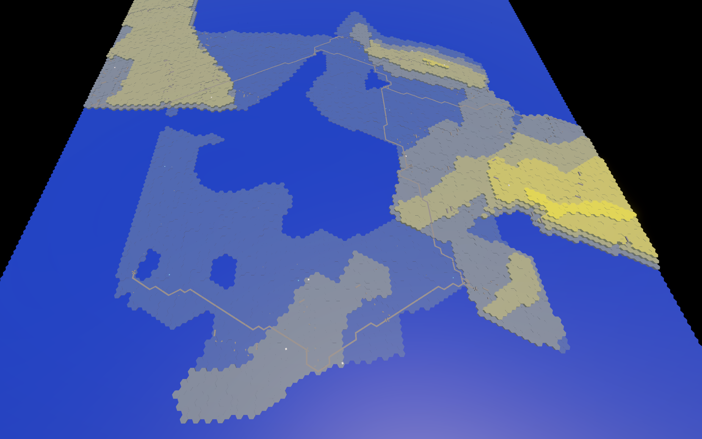

*Topography map*

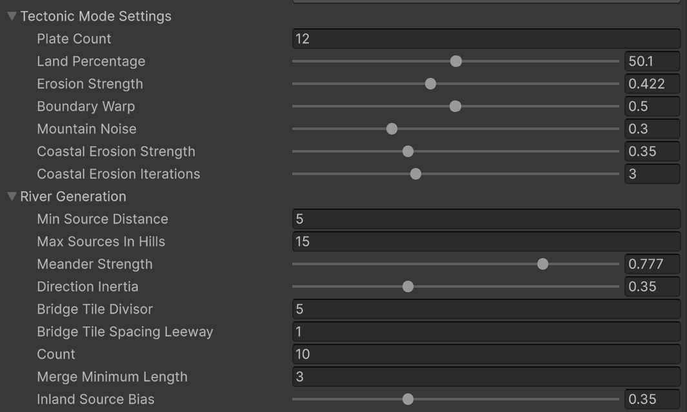

*Most generation parameters can be adjusted to fine-tune the resulting world.*

### Simulated Ecosystem

After terrain generation, the ecosystem is simulated based on geographical and climatic conditions. Temperature influences evaporation and precipitation, while elevation and rainfall affect biome distribution and fertility.

The resulting ecosystem determines the environmental conditions for agriculture and other economic activities. Dark green tiles represent forests, light green tiles represent grasslands, yellow tiles represent farmland, grey tiles represent rocky terrain, and white tiles represent snow.

  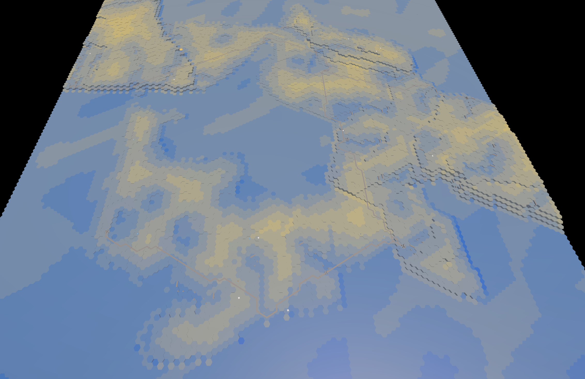
  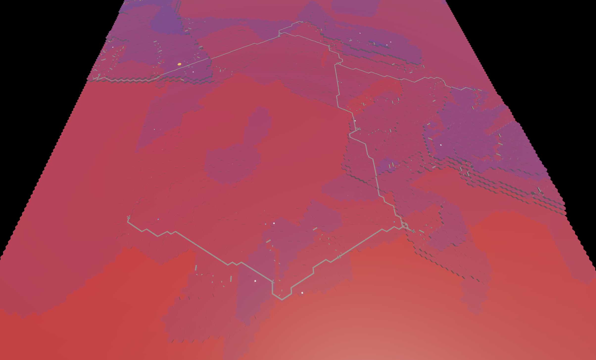
  
<i>Rainfall map (left) and temperature map (right)</i>

  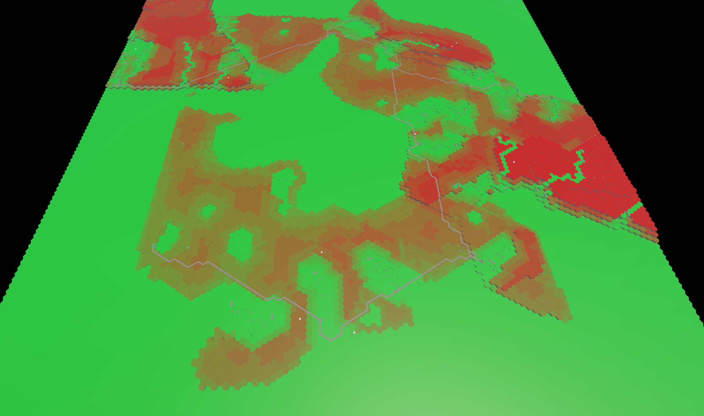
  
<i>Fertility map</i>

### Settlement Placement and Supply Networks

Settlement locations are evaluated based on their environmental suitability and economic potential. Factors include access to fresh water, agricultural fertility, natural resource deposits such as salt and iron, and geographical features such as natural harbours and river mouths.

Each settlement develops a supply area shaped by the surrounding terrain and its traversability. Rivers can extend supply ranges upstream, while different environments influence how quickly and efficiently goods can be transported.

Transportation costs reduce the effective contribution of distant production areas. Additional factors, including consumption, taxes, fees, granary reserve policies, spoilage, and the availability of salt for food preservation, further influence the amount of goods available to a settlement.

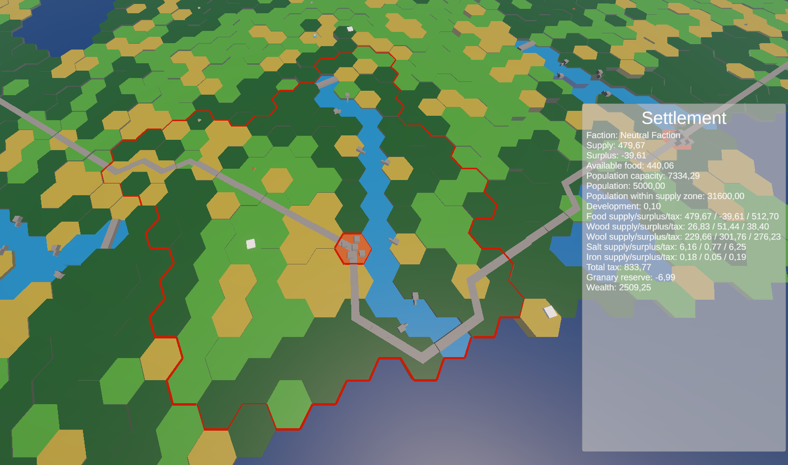

*A settlement with its influence and supply area.*

The settlement placement algorithm combines these factors into a score for each tile, estimating its suitability as a location for a city.

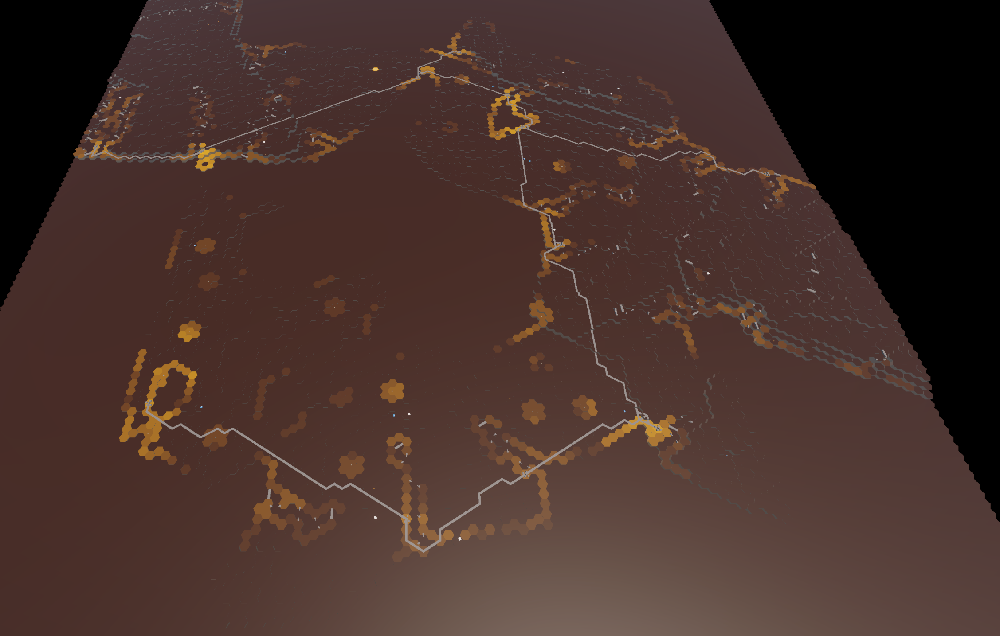

*Settlement suitability score map*

### Simulated Economy

The economy emerges from the interaction between the ecosystem, population, resource availability, and transportation networks.

Agricultural production depends on population and land fertility. The resulting production and supply constraints influence the economic conditions of settlements and their surrounding areas.

  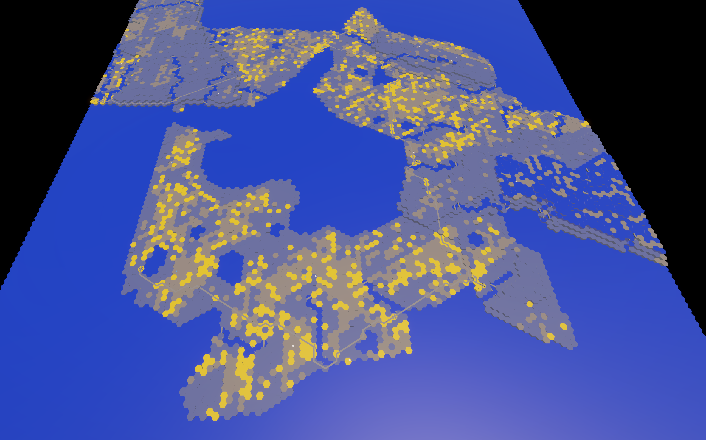
  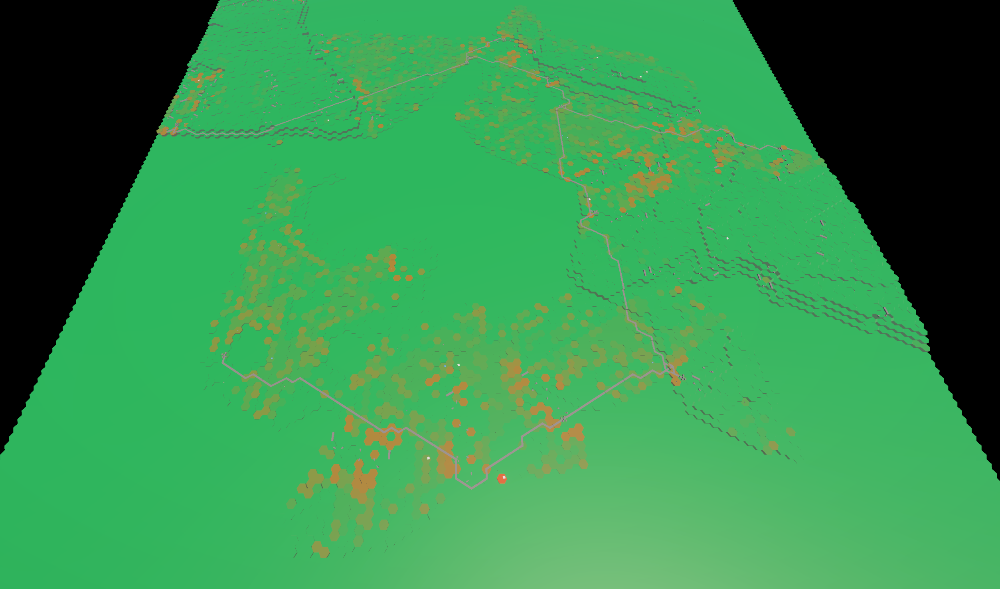
  
<i>Population distribution (left) and production (right)</i>

The simulation uses **wealth** and **security** as key indicators of local economic conditions.

Wealth is influenced by the balance between production and consumption, as well as proximity to busy transportation routes. Security depends on local wealth and the ability of nearby settlements to provide protection.

  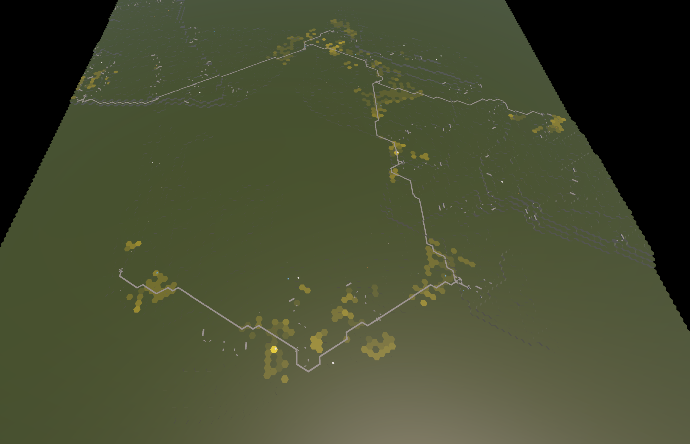
  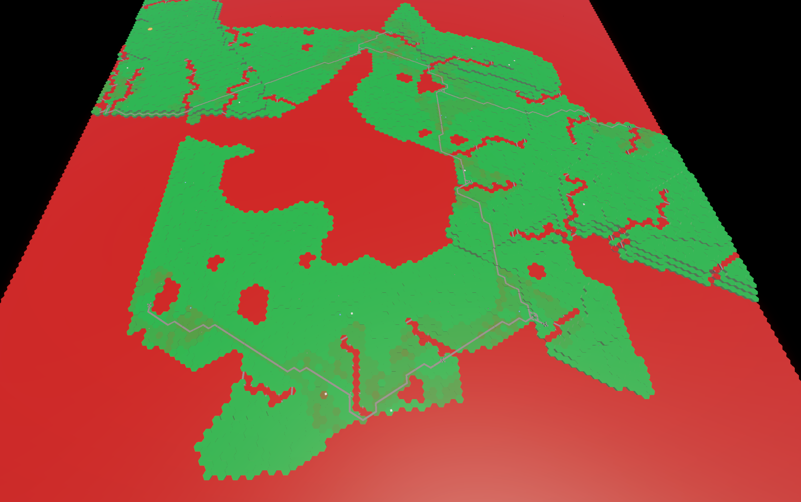
  
<i>Wealth (left) and security (right)</i>

### Planned Additions

Future development will explore additional mechanisms that influence the economy and settlement dynamics.

- **Maritime Transportation:** Modelling sea routes and their influence on trade, transportation costs, and the economic relationships between settlements.
- **Extended Production Chains:** Introducing more detailed production processes, such as producing salt from brine springs using fuel. Different fuel sources will vary in availability and transportation requirements, influencing production costs and regional specialization.
- **Baronies and Regional Administration:** Introducing baronies to address challenges associated with collecting production output from areas far away from cities, collecting tolls, and providing protection to areas beyond the reach of urban settlements.

These additions will further explore how transportation networks, resource availability, production constraints, and regional administration shape economic development in a medieval world.

## Development

### Environment and Tools

The project is developed in the Unity engine using C#.

GitHub Copilot is used extensively as an AI-assisted development tool. LLMs support implementation, debugging, code refinement, and the evaluation of alternative approaches.

### Design Approach

The simulation is built around interconnected systems that model the relationships between geography, climate, natural resources, transportation, settlement patterns, and economic outcomes.

The underlying simulation logic is planned and refined before being translated into code. The focus is on creating a coherent model in which economic outcomes emerge from the interaction of environmental conditions, resource availability, transportation constraints, and settlement dynamics.

Rather than treating cities and their economies as independent entities, the simulation evaluates their development potential based on the characteristics of the surrounding world.

### AI-Assisted Development

The conceptual design of the simulation and its technical implementation are treated as distinct but closely connected tasks.

Simulation rules, assumptions, and intended behavior are manually planned and refined. AI tools are then used to translate these requirements into C# code, explore implementation alternatives, refactor existing code, and investigate potential bugs.

LLMs also serve as sparring partners for examining the plausibility and consistency of the underlying models. They help identify potential edge cases, discuss alternative approaches, and challenge assumptions about how individual mechanisms interact.

AI-generated suggestions are treated as input for further evaluation rather than as authoritative answers. The aim is to combine AI-assisted implementation with deliberate system design and critical assessment of the resulting simulation.

### AI-Assisted Development in Practice

ChatGPT-5.6 Luna, using medium reasoning effort, was responsible for implementing most of the code in this project. Its combination of speed, capability, and low cost made it well suited for rapid iteration, allowing implementations to be revised quickly whenever the results did not meet expectations.

This approach worked well for most tasks. However, several more complex challenges required additional iterations, more guidance, or higher reasoning effort:

- **Directional movement costs in pathfinding:** When implementing the pathfinding system used to calculate the tiles within a city's supply range, the agent struggled to account for different movement costs when traversing river tiles upstream versus downstream. Resolving this issue required multiple prompts and iterations to make the implementation consistent with the intended movement rules.

- **Road visualization:** Getting road segments to connect correctly in the visualization took several iterations. Even when provided with a screenshot of the problem, the agent struggled to identify that the underlying issue was the lack of visual continuity between adjacent road segments. This highlighted a limitation in its ability to interpret spatial relationships and diagnose visual problems from images alone.

- **Performance regressions:** Some changes to existing systems introduced significant performance issues. In these cases, the revised implementations increased computational complexity by repeatedly executing expensive logic tens of thousands of times within a single frame. Identifying and resolving these issues required a better understanding of the underlying algorithms and their execution costs.

- **Geographical landmark detection:** Identifying features such as natural harbours and sea straits proved challenging. The approaches suggested by the agent tended to produce one of two extremes: either too many false positives, effectively classifying large portions of the coastline as landmarks, or no detections at all. Finding a more balanced approach required further iteration and refinement of the detection criteria.

These experiences demonstrated that AI-assisted development is most effective when combined with an understanding of the underlying technical problems. Switching to higher reasoning effort helped with some of the more complex challenges, while a general understanding of the algorithms made it possible to guide the agent toward more suitable solutions.

In several cases, the most effective approach was collaborative problem-solving through dialogue: analyzing the observed behavior, narrowing down possible causes, challenging proposed solutions, and refining the implementation step by step. Rather than relying on the agent to solve every problem independently, I used it as a development partner whose output required evaluation, direction, and occasional correction.

### Iterative Development and Evaluation

Development follows an iterative process: simulation concepts are translated into code, the resulting behavior is inspected, and both the implementation and the underlying assumptions are refined as needed.

Visualizations of terrain, rainfall, fertility, settlement suitability, population, production, wealth, and security make intermediate results observable. These outputs help investigate unexpected patterns and understand how individual mechanisms influence the overall simulation.

Particular attention is given to the interactions between subsystems. For example, transportation costs and spoilage affect the effective supply available to a settlement, while environmental conditions influence agricultural production and therefore its economic potential.

### Scope and Limitations

The project is an ongoing simulation experiment. Its models aim to explore plausible relationships in a medieval-inspired economy rather than reproduce historical reality in every detail.

The realism of the results depends on the assumptions, abstractions, and parameters used by the simulation. Plausible-looking visualizations alone are not sufficient to establish that a model is historically or economically accurate.

The simulation models and their interactions will continue to evolve as the project develops.

## Project Status

The project is under active development. Simulation models, parameters, and features may change as the underlying systems evolve.
